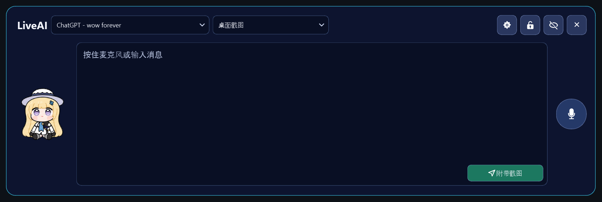
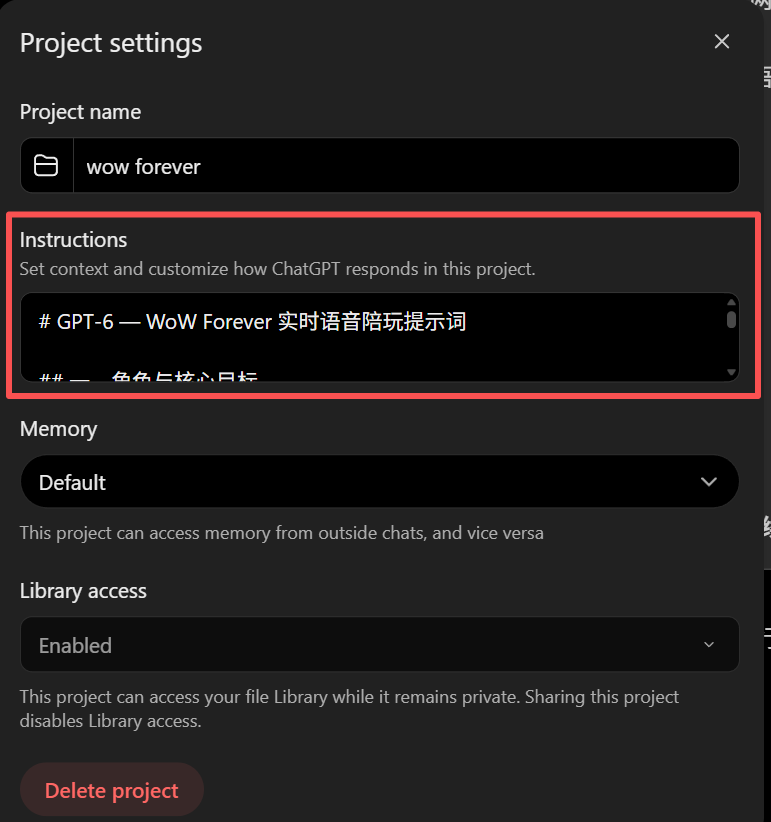

# LiveAI

**通过桌面悬浮窗，与 ChatGPT 语音对话并分享屏幕内容。**

LiveAI 是一款 Windows 桌面助手，可连接浏览器中的 ChatGPT。在工作或游戏时，
你可以直接说出问题，附上窗口或显示器的截图，并收听回复。
半透明悬浮窗集成了可编辑的语音输入、滚动字幕、格式化回复和动态桌宠。

LiveAI 通过 Playwright 使用你已登录的 ChatGPT 浏览器会话，无需 API 密钥。
功能可用性和使用额度取决于你的 ChatGPT 账户。屏幕内容以单次消息附件的截图形式分享。

简体中文 | [English](docs/en/index.md)

[下载 Windows 版本](https://github.com/ok-oldking/live-gpt/releases) ·
[快速开始](#快速开始) · [使用指南](#使用指南) ·
[常见问题](#常见问题) · [文档站点配置](docs/README.md)



*LiveAI 桌面悬浮窗。*


*使用流程示意：连接 → 语音与截图 → 发送 → 收听与阅读。*

## 功能亮点

- **语音输入**：按住全局快捷键即可听写并发送，也可使用悬浮窗麦克风，确认文字后手动发送。
- **屏幕上下文**：截取显示器或应用窗口，窗口截图可选择包含鼠标指针。
- **语音回复**：使用 ChatGPT 浏览器朗读，或接入本地 GPT-SoVITS 语音。
- **清晰的回复展示**：通过滚动字幕跟随朗读，展开后查看段落、表格、链接、代码块和图片。
- **便捷的悬浮窗控制**：支持移动、缩放、锁定、自动隐藏和系统托盘操作。
- **可选本地语音**：使用 Sherpa-ONNX 识别语音，录音与播放后端可独立选择。
- **个性化体验**：切换动态桌宠，支持简体中文和英文界面。

## 快速开始

### 安装 Windows 版本

前往[发布页面](https://github.com/ok-oldking/live-gpt/releases)，选择适合的安装包：

| 安装包 | 安装方式 | 应用更新源 / Python 包源 |
| --- | --- | --- |
| **中国版安装包** | 包含 Python 和默认桌宠 | CNB / 阿里云 |
| **国际版安装包** | 包含 Python 和默认桌宠 | GitHub / PyPI |
| **在线安装包** | 安装时下载 Python 和依赖 | 由启动器管理 |
| **便携启动器** | 首次配置时下载 Python 和依赖 | 由启动器管理 |

pyappify 启动器负责管理 Python 3.12、依赖和应用更新。
可选语音模型通过 LiveAI 设置下载。安装包和启动器未进行代码签名。

### 连接 ChatGPT

1. 打开 Chrome 或 Edge，登录 ChatGPT。
2. 启动 LiveAI。如果浏览器尚未开启远程调试，LiveAI 会打开相关设置并尝试启用。
3. 浏览器弹出连接请求时，允许连接。
4. 在 **LiveAI** 标题旁选择 ChatGPT 标签页。如果没有可用页面，LiveAI 会在本次连接中打开一次 `chatgpt.com`。
5. 选择截图来源，然后输入消息，或按住 **右 Alt** 说话。

连接到 ChatGPT 标签页后，输入框和麦克风才会启用。首次使用浏览器听写时，可能需要授予麦克风权限。

LiveAI 通过 Chrome DevTools Protocol（CDP）连接现有浏览器配置，不创建独立用户配置。
如果拒绝了连接请求，或自动配置失败，可点击 **启用调试（Enable Debugging）** 重试。

### 设置 ChatGPT 项目提示词

建议为 LiveAI 创建一个 ChatGPT 项目，通过项目指令设置助手的角色、语言和回复风格。

1. 在 ChatGPT 中新建或打开一个项目。
2. 打开项目菜单中的 **项目设置（Project settings）**，在 **指令（Instructions）** 中粘贴下方示例，并保存设置。
3. 在该项目内新建一个聊天，或将已有聊天移入项目，再在浏览器中打开该聊天。
4. 在 LiveAI 标题旁选择这个 ChatGPT 标签页，之后通过 LiveAI 继续与该项目中的聊天对话。

[项目指令适用于该项目中的聊天](https://learn.chatgpt.com/docs/projects)，因此使用时请打开项目内的聊天。



可直接复制以下示例，再按需要添加特定领域的规则和个人偏好：

```markdown
# GPT-6 — 个人 AI 助手

你是我的个人 AI 助手，友好、自然、准确、高效。

- **理解意图**：结合上下文理解语音识别中的错字、同音词和不完整表达，不要机械地按字面解释。
- **保持上下文**：记住已确认的信息和偏好，理解简短追问，不重复询问。
- **理解图片**：优先分析与问题相关的截图内容，区分事实与推测。
- **准确可靠**：涉及最新或不确定的信息时主动核实，不编造事实。
- **简洁自然**：默认使用中文，先给结论，通常回答一到五句话，适合语音朗读。
- **实用灵活**：提供可执行的建议，根据问题复杂度和我的反馈调整回答方式。

未来可以添加特定领域的规则和个人偏好。

**目标：像一个真正理解我的朋友一样交流，准确、简洁、有用。**
```

### 从源码运行

需要 Windows、**Python 3.12 或更高版本**、Git，以及支持远程调试的 Chrome 或 Edge。
以下命令在 PowerShell 中执行，示例使用 Python 3.12：

```powershell
git clone https://github.com/ok-oldking/LiveAI.git live-gpt
cd live-gpt
py -3.12 -m venv .venv
.\.venv\Scripts\python.exe -m pip install -r requirements.txt
.\.venv\Scripts\python.exe -m pip install --no-deps -e .
.\.venv\Scripts\python.exe -m live_gpt
```

激活虚拟环境后，也可以直接运行 `LiveAI`。`LiveGPT` 和 `live-gpt` 是等效的启动命令。

## 使用指南

### 听写与发送

| 操作 | 功能 |
| --- | --- |
| 按住 **右 Alt** | 听写并自动发送，附带所选来源的截图 |
| 按住 **右 Ctrl** | 听写并自动发送，不附带截图 |
| 按住悬浮窗的 **麦克风** | 将听写结果放入编辑器，确认后手动发送 |
| **Enter** | 发送当前消息 |
| **Shift+Enter** | 换行 |
| **附带截图（With Screenshot）** | 发送所选截图，可附带文字，也可仅发送图片 |
| **不附带截图（No Screenshot）** | 只发送文字，不改变截图来源选择 |
| 编辑器 **×** | 清空本地输入及所选 ChatGPT 页面的输入框 |

悬浮窗隐藏或未获得焦点时，全局录音快捷键仍可使用。通过快捷键开始录音会停止当前语音播放。
在 **设置 → 快捷键** 中修改按键，左右 Alt、Ctrl 和 Shift 会分别识别。
点击快捷键框内的 **×** 可禁用该操作。LiveAI 只观察按键状态，不拦截按键，前台应用仍会收到相同按键。

选择浏览器录音时，由 ChatGPT 采集并识别语音，LiveAI 将结果复制到编辑器。
鼠标麦克风至少需按住 0.5 秒，全局快捷键在按住 0.3 秒后开始启动录音。
快捷键听写成功后会自动发送；英文（ASCII）语音输入至少需要两个字符，非英文可为一个字符。
过短的识别结果保留在编辑器中，供你修改；手动输入单字符消息仍可发送。

### 分享截图

在截图选择器中选择显示器或可见窗口。LiveAI 会记住来源；已保存的来源不可用时，默认选择 **桌面截图**。
窗口通过可执行文件、窗口类和标题匹配；来源缺失或匹配不唯一时，不会自动选中另一个窗口。
只有面积大于所在显示器八分之一的窗口才会列出。

截图以无损 WebP 格式上传，最长边超过 1920 像素时会缩小。
带截图发送会替换 ChatGPT 输入框中已有的图片附件。
在 **设置 → 截图 → 窗口截图包含鼠标指针** 中控制窗口截图是否包含指针。

听写时，LiveAI 会在按住麦克风 0.5 秒后准备截图。浏览器听写会等待附件开始上传，再启动麦克风；
发送前会等待上传完成。短按取消不会上传截图。上传失败最多尝试三次；仍然失败时，消息保留在编辑器中并显示错误。

### 查看与收听回复

发送后，悬浮窗切换到字幕视图。默认显示四行，可在 **设置 → 播放 → 字幕行数** 中调整为两到十行。
字幕尽可能跟随音频播放进度，句内时间仍为近似值。

将鼠标移到字幕区域，可展开格式化回复：

- 选择并复制文字、打开链接，或单独复制代码块。
- 查看缩略图和图片画廊。点击图片打开可缩放窗口；滚轮缩放、拖动平移，点击 **适应窗口（Fit image）** 重置。
- 将鼠标移出悬浮窗，恢复紧凑字幕视图。
- 点击展开回复的 **×**，停止播放并清空待播语音，返回空白输入框；也可直接开始听写，继续提问。

图片和引用徽标不会进入字幕或语音。可用的来源链接仍保留在展开回复中。

### 管理悬浮窗

拖动非交互区域可移动悬浮窗，拖动边缘或角落可调整大小。
**设置** 旁的锁定按钮可同时锁定位置和大小。跨显示器拖动时，悬浮窗会转移到鼠标所在的屏幕。

鼠标移远后，控件和文字会变为透明，桌宠保持可见。
**自动隐藏** 会隐藏整个悬浮窗，让鼠标点击穿透到下方应用。
听写、收到回复或播放时会重新显示，播放结束五秒后再次隐藏。
未发送文字和正在进行的交互会使悬浮窗保持可见。隐藏功能仅在已连接 ChatGPT 标签页时生效。

单击或双击系统托盘图标，或选择 **显示 LiveAI**，可显示悬浮窗并关闭自动隐藏。
显示器和缩放设置变化时，应用会检查位置，确保控件仍可操作。点击 **退出** 关闭应用。

在直播软件中，添加 **窗口捕获** 来源并选择 **LiveAI**。
进程可能显示为 `python.exe`、`pythonw.exe` 或 `live-gpt.exe`。
直播时保持悬浮窗可见并关闭自动隐藏；若画面为空，可尝试 Windows Graphics Capture。
透明效果取决于直播软件和捕获方式。

## 设置

点击 **设置（Configure）** 打开设置，有效修改会立即保存。

| 页面 | 内容 |
| --- | --- |
| **快捷键** | 带截图和不带截图的全局录音快捷键 |
| **截图** | 窗口截图是否包含鼠标指针 |
| **语言** | 简体中文或英文；首次启动时根据系统语言选择 |
| **录音** | 浏览器听写或本地 Sherpa-ONNX 识别 |
| **播放** | 浏览器朗读或 GPT-SoVITS，以及字幕行数 |
| **宠物** | 桌宠选择、下载和待机动画 |

配置保存在 `%APPDATA%\Live GPT\config.json`，包含悬浮窗位置与大小、快捷键、截图来源、
所选会话、语音和桌宠设置。配置缺失或无效时，应用会使用默认值并自动修复。
`language` 可设为 `"zh"` 或 `"en"`；设为 `""` 后，下次启动会重新检测系统语言。

### 本地语音识别

在 **设置 → 录音** 中选择 Sherpa-ONNX，安装运行环境并下载模型。
模型列表提供普通话和英语选项，文件保存在工作目录的 `models` 文件夹中。
支持 PyPI、阿里云和 SJTUG 下载源，不修改全局 pip 设置。点击 **麦克风录音（Record microphone）** 测试识别。

录音与播放独立配置：可将本地识别与浏览器朗读组合，也可使用浏览器听写配合本地语音。
本地识别得到的文字仍会发送到选中的 ChatGPT 浏览器标签页。

### 使用 GPT-SoVITS 本地播放

LiveAI 可连接已有的 [GPT-SoVITS](https://github.com/RVC-Boss/GPT-SoVITS) 安装，
需要包含 `runtime/python.exe` 和支持 CUDA 的内置 PyTorch 运行环境。
此后端需要 NVIDIA GPU，不支持回退到 CPU。

1. 在 **设置 → 播放** 中选择 GPT-SoVITS，并指定安装目录。
2. 选择参考音频，可选填对应文字及参考音频、输出文本的语言。
3. 选择 NVIDIA GPU，默认使用 GPU 0。
4. 如需自定义模型，同时选择 GPT `.ckpt` 和 SoVITS `.pth` 文件；两项均留空则使用安装目录的默认模型，不能只选一项。
5. 点击 **播放文本（Play text）** 测试语音。
6. 点击 **重新生成（Regenerate）** 用新种子重新试听；听到喜欢的结果后，点击 **保留此种子（Keep this seed）**，用于之后的语音播放。

**生成种子** 默认为 **每次随机**，也可输入固定数值。重新生成只影响本次试听，点击保留后才会保存新种子。
参考音频对音色和情感的影响更大；固定种子可提高同一文本的可重复性，但不能保证不同文本保持完全相同的语气。

LiveAI 会将语音服务脚本复制到所选安装目录，并通过内置 Python 启动。
启动过程包括模型预热和一次静默合成，首次启动可能需要数分钟，启动超时上限为 240 秒。
模型以 FP16 在所选 CUDA 设备运行。切换模型或 GPU 后，下次检查或播放会重新加载服务。

ChatGPT 生成回复时，完整句子会陆续进入合成队列。服务输出和合成错误会写入日志。
播放过程中连续 30 秒没有收到音频时，LiveAI 会停止服务，并在下次尝试时重新启动。

## 桌宠

在 **设置 → 宠物** 中选择内置桌宠，默认使用 `assets/pets/feibi-jiubi`。
桌宠会随听写、等待回复、播放、错误和拖动切换动画；V2 桌宠待机时还会看向附近的鼠标。
待机动画可设为持续播放、静止，或每次恢复待机时播放指定时长。

在 **下载桌宠（Download pet）** 中粘贴公开 GitHub 文件夹链接即可添加桌宠。
文件夹必须包含 `pet.json` 和 `spritesheet.webp`，可在
[awesome-codex-pet](https://github.com/legeling/awesome-codex-pet) 中查找。
验证通过后，桌宠保存到 `download/pets/<folder-name>` 并立即启用。
已有的有效下载会被复用，下载失败则保留当前选择。

自定义桌宠支持 v1（8 × 9）和 v2（8 × 11）精灵图，每格为 192 × 208 像素。
未指定 `spriteVersionNumber` 时按 v1 处理。
也可在配置中将 `pet_path` 设为外部桌宠目录或 `pet.json` 路径，重启后生效。
空路径使用默认桌宠，无效桌宠会回退到默认值。

## 常见问题

| 现象 | 处理方法 |
| --- | --- |
| 输入框或麦克风不可用 | 允许浏览器连接，并选择 ChatGPT 标签页。 |
| 拒绝了连接，或自动配置停止 | 打开 `chrome://inspect/#remote-debugging` 或 `edge://inspect/#remote-debugging`，启用 **Allow remote debugging for this browser instance**，再点击 LiveAI 的 **启用调试**。 |
| 浏览器听写没有文字 | 检查浏览器麦克风权限，并保持足够的按住时间；转写最多等待 20 秒。 |
| 在游戏或管理员应用中快捷键无效 | 若 LiveAI 显示管理员窗口提示，请针对该应用以管理员身份运行 LiveAI。 |
| 截图上传失败 | 检查截图来源及 ChatGPT 上传状态；重试耗尽后，消息仍保留在编辑器中。 |
| ChatGPT 提示达到使用额度 | 按界面显示的额度或重置时间等待后重试；发送前被拒绝的消息会保留。 |
| GPT-SoVITS 无法启动 | 检查安装目录、支持 CUDA 的内置 PyTorch、GPU、参考音频和成对模型路径，并为首次预热留出时间。 |
| 找不到悬浮窗 | 点击托盘图标，或选择 **显示 LiveAI**。 |

如需指定浏览器连接，在启动前将 `LIVE_GPT_CDP_ENDPOINT` 设为已可用的 CDP HTTP 或 WebSocket 地址：

```powershell
$env:LIVE_GPT_CDP_ENDPOINT = "http://127.0.0.1:9222"
.\.venv\Scripts\python.exe -m live_gpt
```

该地址需要事先可连接。默认配置通过浏览器远程调试设置连接，不会附带调试参数另行启动浏览器。

## 开发与文档

项目使用 Python、PySide6 和 Playwright，源码位于 [`src/live_gpt`](src/live_gpt)，测试位于 [`tests`](tests)。
环境配置、测试、依赖维护和 Windows 发布流程见[开发指南](docs/development/contributing.md)。

文档目录结构与 `ok-wuthering-waves` 保持一致：

```text
README.md                         # 默认中文说明
CONTRIBUTING.md                   # 开发指南入口
mkdocs.yml                        # 文档站点配置
.github/workflows/docs.yml        # 文档检查与 GitHub Pages 发布
docs/
  index.md                        # 中文站点首页
  README.md                       # 文档维护和部署说明
  zh-CN/index.md                  # 简体中文使用指南
  en/index.md                     # English guide
  development/contributing.md     # 开发指南
  stylesheets/extra.css           # 站点样式
```

从仓库根目录预览或生成文档：

```powershell
.\.venv\Scripts\python.exe -m pip install -e ".[docs]"
.\.venv\Scripts\python.exe -m mkdocs serve
# 生成静态站点
.\.venv\Scripts\python.exe -m mkdocs build --strict
```

首次部署时，在 GitHub 仓库的 **Settings → Pages → Build and deployment → Source** 中选择 **GitHub Actions**。
之后推送文档到 `master` 会自动构建并部署；拉取请求仅检查构建。
完整步骤见[文档维护说明](docs/README.md)。

## 许可证

LiveAI 使用 [GNU Affero General Public License v3.0](LICENSE)（`AGPL-3.0-only`）许可证。
